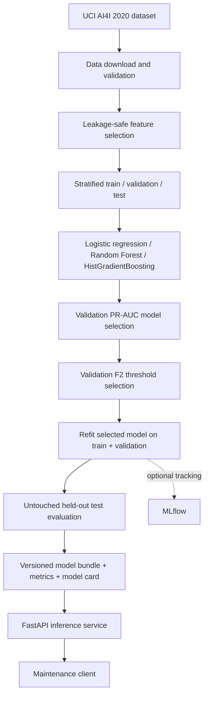

# Architecture

## Design decisions

- **Leakage prevention:** remove row/product identifiers and the five failure-mode sublabels; use only six operational/product features and the aggregate Machine failure label.
- **Rare-event evaluation:** rank candidates on validation average precision (PR-AUC), not accuracy. Select a decision threshold on validation data using F2 to weight recall more heavily.
- **Honest test reporting:** retain a stratified 20% hold-out until model and threshold selection are complete.
- **Serving contract:** validate sensor ranges and reject unexpected input fields at the API boundary.
- **Artifact provenance:** store selected model name, feature list, threshold, project version, test metrics and limitations alongside the serialized pipeline.

## Run order

1. `python scripts/download_data.py`
2. `python -m pdm.train --data data/ai4i2020.csv --output artifacts`
3. `uvicorn pdm.api:app --reload`
4. `pytest -q`
